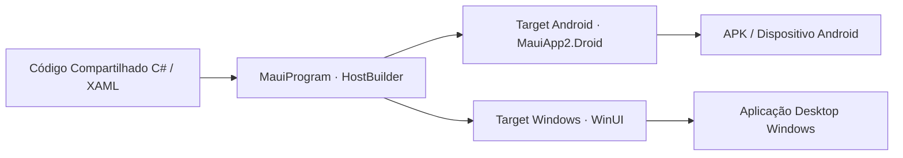

<p align="center">
  
</p>

<p align="center">Aplicação de estudo com interface compartilhada e suporte a Android e Windows.</p>

<p align="center">
  
  
  
</p>

<p align="center"><a href="#visão-geral">Visão geral</a> &nbsp;·&nbsp; <a href="#recursos">Recursos</a> &nbsp;·&nbsp; <a href="#como-executar">Como executar</a></p>

---

## Visão geral

A solução (MauiApp2.sln) está organizada com separação explícita entre o núcleo compartilhado e os cabeçalhos de plataforma (MauiApp2.Droid para Android com MainActivity e recursos mipmap/drawable, além do suporte desktop Windows), permitindo compilar e depurar a partir de uma base única.

## Recursos

| Recurso | Como funciona |
|---|---|
| Base de código unificada | Lógica em C# e telas compartilhadas entre dispositivos móveis e desktop. |
| Host nativo Android | Projeto MauiApp2.Droid com AndroidManifest.xml, MainApplication.cs e ícones adaptativos em múltiplas densidades (hdpi a xxxhdpi). |
| Pipeline MauiProgram | Inicialização centralizada com padrão *HostBuilder* para registro de fontes, serviços e ciclo de vida. |
| Destino .NET 9 | Configurado para aproveitar as otimizações de compilação e runtime do SDK .NET 9. |

## Tecnologias

- **C# & .NET 9** como linguagem e plataforma de execução;
- **.NET MAUI** para abstração de componentes visuais multiplataforma;
- **Android SDK** para empacotamento e execução em emuladores ou dispositivos físicos Android.

<details>
<summary>Arquitetura</summary>



</details>

<details>
<summary>Estrutura do repositório</summary>

```text
MauiAPP/
├── assets/
│   └── project-animal.png          Emblema do projeto
├── MauiApp2/
│   ├── MauiApp2.Droid/                     Projeto nativo Android (Manifest, MainActivity, Resources)
│   └── ...                                 Arquivos compartilhados da solução MAUI
├── MauiApp2.sln                            Solução Visual Studio
├── MauiApp-master.zip                      Snapshot compactado do projeto original
└── README.md
```

</details>

## Como executar

1. Certifique-se de ter o **SDK .NET 9** e a workload do MAUI instalada (dotnet workload install maui).
2. Clone o repositório:
   ```powershell
   git clone https://github.com/arthurlynow098/MauiAPP.git
   cd MauiAPP
   ```
3. Abra MauiApp2.sln no **Visual Studio 2022** e selecione o emulador Android ou a máquina Windows para iniciar a depuração.

---

<p align="center">
  <a href="https://github.com/arthurlynow098">GitHub</a> &nbsp;·&nbsp;
  <a href="https://arthurentsev.vercel.app/">Portfólio</a> &nbsp;·&nbsp;
  <a href="https://www.linkedin.com/in/entsevarthur/">LinkedIn</a>
</p>
