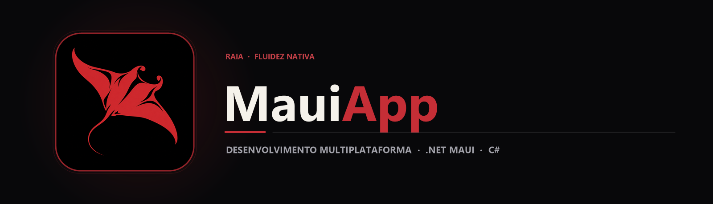

  

  Aplicação multiplataforma desenvolvida em C# e .NET MAUI (.NET 9) com núcleo de interface compartilhado e empacotamento nativo para Android e Windows.

  
  
  

## Sobre o projeto

O desenvolvimento multiplataforma moderno busca compartilhar a maior parte possível das regras de negócio e das telas em XAML/C# sem abrir mão do desempenho e das APIs nativas de cada sistema operacional. Este projeto acadêmico explora o **.NET MAUI (.NET Multi-platform App UI)** sobre o **.NET 9**.

A solução (MauiApp2.sln) está organizada com separação explícita entre o núcleo compartilhado e os cabeçalhos de plataforma (MauiApp2.Droid para Android com MainActivity e recursos mipmap/drawable, além do suporte desktop Windows), permitindo compilar e depurar a partir de uma base única.

## Principais recursos

| Recurso | Como funciona |
|---|---|
| Base de código unificada | Lógica em C# e telas compartilhadas entre dispositivos móveis e desktop. |
| Host nativo Android | Projeto MauiApp2.Droid com AndroidManifest.xml, MainApplication.cs e ícones adaptativos em múltiplas densidades (hdpi a xxxhdpi). |
| Pipeline MauiProgram | Inicialização centralizada com padrão *HostBuilder* para registro de fontes, serviços e ciclo de vida. |
| Destino .NET 9 | Configurado para aproveitar as otimizações de compilação e runtime do SDK .NET 9. |

## Tecnologias

  
  
  
  
  

- **C# & .NET 9** como linguagem e plataforma de execução;
- **.NET MAUI** para abstração de componentes visuais multiplataforma;
- **Android SDK** para empacotamento e execução em emuladores ou dispositivos físicos Android.

## Arquitetura

`mermaid
flowchart LR
    A[Código Compartilhado C# / XAML] --> B[MauiProgram · HostBuilder]
    B --> C[Target Android · MauiApp2.Droid]
    B --> D[Target Windows · WinUI]
    C --> E[APK / Dispositivo Android]
    D --> F[Aplicação Desktop Windows]
`

## Estrutura do repositório

`	ext
MauiAPP/
├── assets/
│   ├── banner.png                          Banner principal MauiApp
│   └── project-animal.png                  Símbolo da raia manta
├── MauiApp2/
│   ├── MauiApp2.Droid/                     Projeto nativo Android (Manifest, MainActivity, Resources)
│   └── ...                                 Arquivos compartilhados da solução MAUI
├── MauiApp2.sln                            Solução Visual Studio
├── MauiApp-master.zip                      Snapshot compactado do projeto original
└── README.md
`

## Executando o código

1. Certifique-se de ter o **SDK .NET 9** e a workload do MAUI instalada (dotnet workload install maui).
2. Clone o repositório:
   `powershell
   git clone https://github.com/arthurlynow098/MauiAPP.git
   cd MauiAPP
   `
3. Abra MauiApp2.sln no **Visual Studio 2022** e selecione o emulador Android ou a máquina Windows para iniciar a depuração.

---

Estudo · construção · evolução <a href="https://github.com/arthurlynow098">Perfil</a> · <a href="https://arthurentsev.vercel.app/">Portfólio</a> · <a href="https://www.linkedin.com/in/entsevarthur/">LinkedIn</a>

